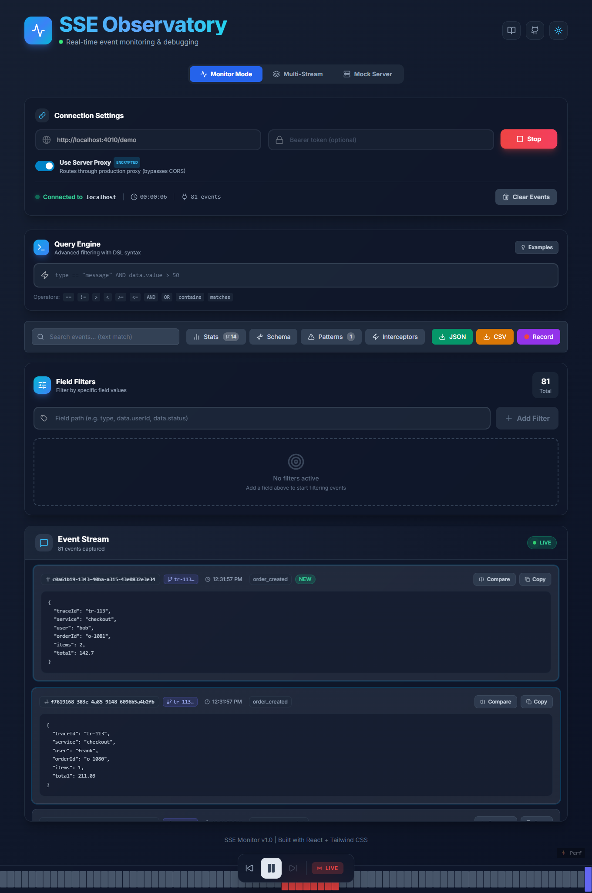
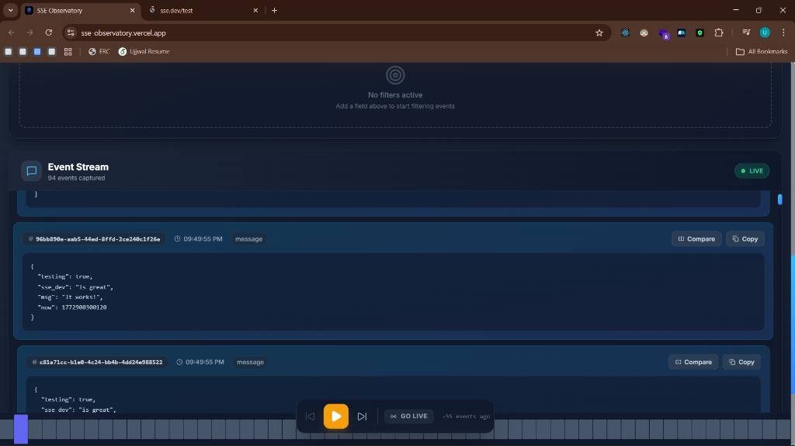
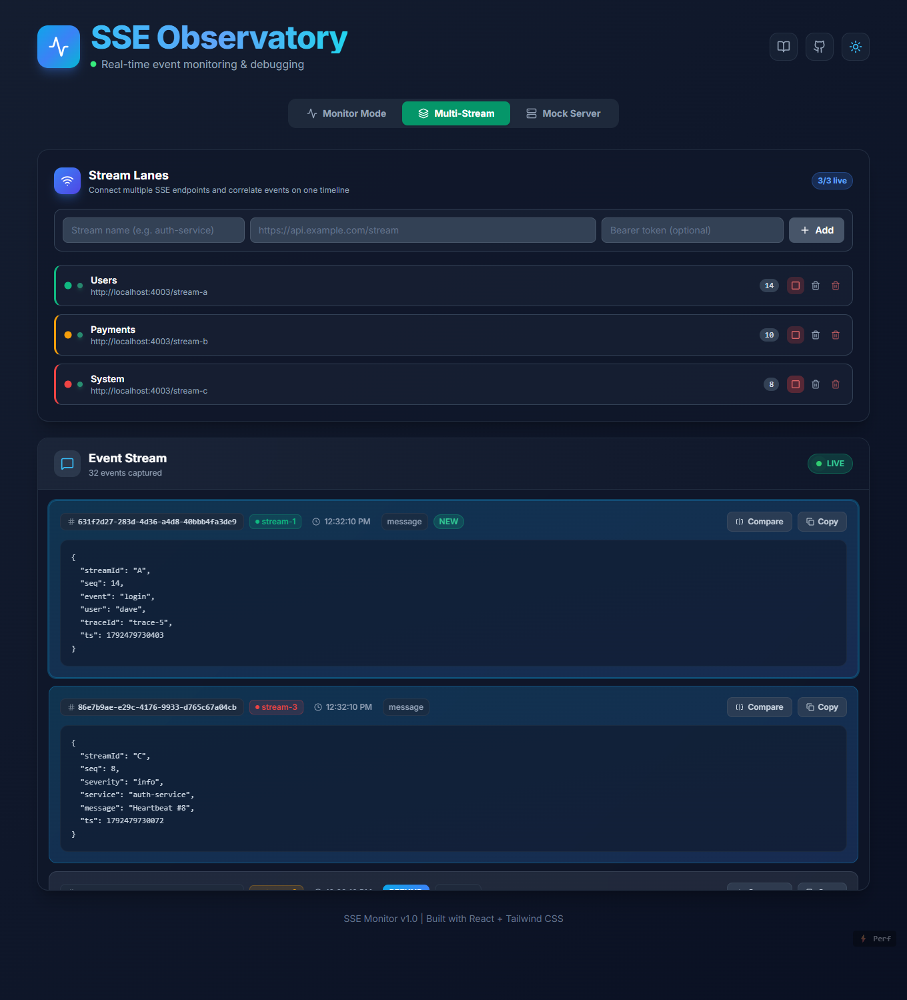
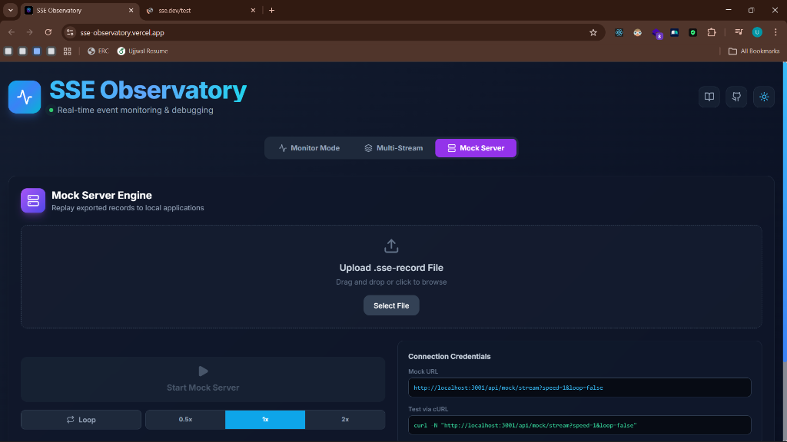
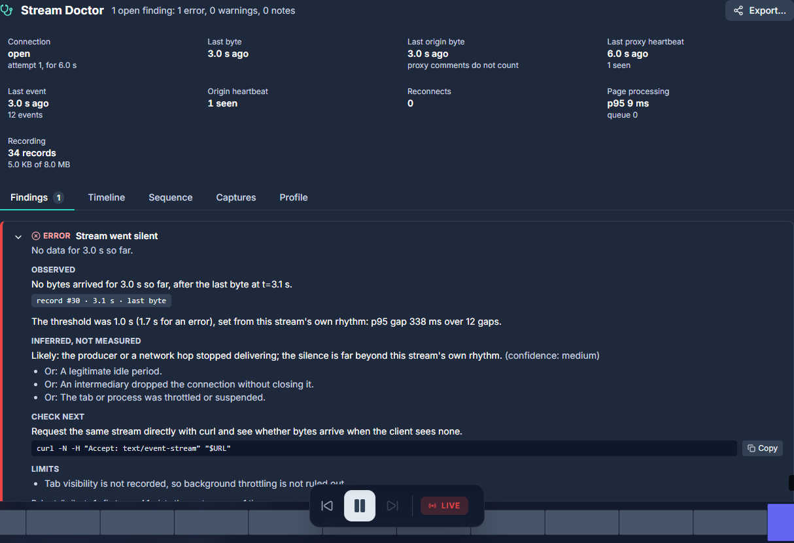
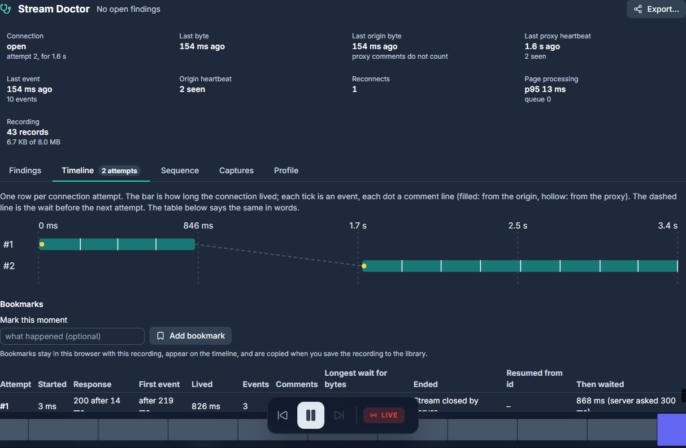
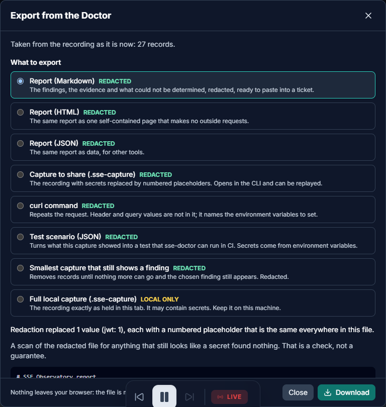

# 🛸 SSE Observatory

<div align="center">
  
  <h3>Real-Time Observability for Server-Sent Event Streams</h3>
  <p><a href="https://sse-observatory.vercel.app">Live demo</a> · <a href="https://sse-observatory.vercel.app/docs/">Documentation</a></p>
</div>

## 1. Overview of the Problem Solved

Debugging **Server-Sent Events (SSE)** in production is hard. Browser network tools show raw frames but offer little filtering, search or transformation, and logging every event to the console makes the page sluggish at high rates.

**SSE Observatory** is a browser-native debugging toolkit. It lets you inspect, filter, transform, correlate and replay event streams without any extra backend logging or APM, and it stays responsive under heavy load because parsing, filtering and sandboxed code all run off the main thread with every buffer bounded.

Since v2 it also answers the harder question, **why** a stream is stuck, late or losing events, and turns the answer into a regression test: **Inspect, Diagnose, Reproduce, Test, Monitor** (see [the Stream Doctor](#the-stream-doctor)).

## 2. Platform Showcases

### 🔍 Monitor Mode
Connect to a stream, filter it live with the query language, search payloads, pause and step through events, and inspect each payload.



### 📊 Event Stream & Analysis
Schema inference, pattern alerts (here an error burst raised exactly one alert), trace correlation and payload diffing.



### 🏎️ Multi-Stream
Run several streams side by side, merged newest-first on one list. Each lane connects, disconnects and clears on its own.



### 🛠️ Mock Server
Upload an exported `.sse-record`, get a private replay URL (0.5x, 1x or 2x, optional loop) and point Monitor Mode at it to reproduce an incident.



### 🩺 Stream Doctor
Says what looks wrong with a stream and shows the evidence: a stream that went quiet, with what was measured, what is only inferred ("Likely: …", with the other explanations) and what the check cannot know.



One row per connection attempt, with the `Last-Event-ID` each one resumed from and how long the client waited:



Export a report, a shareable capture, a curl command or a test scenario. Redaction shows what it replaced, and a scan gates sharing:



## 3. Key Features

- **Spec-compliant SSE client:** fetch-based, with named events, `Last-Event-ID` resume, exponential backoff with jitter, and a clear difference between retryable failures and fatal ones (wrong URL, 401/403/404, wrong content type). `event: end` or a 204 stops a stream for good.
- **Multi-Stream:** any number of lanes, each with an optional bearer token, merged into one list.
- **Bounded, responsive pipeline:** the newest 1,000 events live in memory, the newest 100,000 in IndexedDB. Bursts are parsed and ingested in time-boxed slices, so a 20,000-event burst never blocks the page.
- **Query language:** `==`, `!=`, `>`, `>=`, `<`, `<=`, `contains`, `matches`, `in [..]`, `exists`, `AND`, `OR`, `NOT` and parentheses over event fields or payload paths (for example `type == "payment_failed" AND data.amount >= 100`).
- **Interceptor sandbox:** write JavaScript to rewrite or drop events before they are stored. It runs in a locked-down Worker with no network or storage, no `eval`/`Function`, and a 100 ms kill timer.
- **Schema inference:** a live view of field names, types and frequencies from recent payloads.
- **Trace correlation:** groups events by `traceId`, `requestId`, `correlationId` or `transactionId` (and their snake_case, kebab-case and `x-` variants) into causal chains.
- **Pattern detection:** burst rules (at least N matching events in a window, one alert per burst) and consecutive-sequence rules, evaluated incrementally.
- **Mock server and replay:** export a session, replay it from a private URL at adjustable speed; finished replays send `event: end`.
- **Secure proxy:** `/api/sse` relays streams for sites without CORS. It is closed by default in production, blocks private and metadata addresses after DNS resolution, pins the connection to the validated IP and keeps tokens out of URLs.
- **Resilient transport:** one connection per URL shared across tabs through a SharedWorker; if the worker is missing or dies, the tab notices and carries on in the page.
- **Stream Doctor:** fourteen rules over what the client observed (status and content type, framing, first-event timing, silences, bursts, reconnect loops, resume with `Last-Event-ID`, sequence gaps and duplicates, heartbeats, slow consumers, credentials in the request, proxy masking), each shown as facts, deductions and limits, with the records behind them.
- **Capture, redact, replay, test:** `.sse-capture` files with redaction by numbered placeholders, a `sse-doctor` command line, and scenarios that turn a captured failure into a CI check.

### The Stream Doctor

| Step | In the app | On the command line |
|---|---|---|
| **Inspect** | the viewer | `sse-doctor probe <url>` records a stream |
| **Diagnose** | the Doctor panel: findings, timeline, sequence | `sse-doctor analyze <capture>`, `report` |
| **Reproduce** | Export a capture; Replay in Mock mode | `sse-doctor replay`, `repro` (smallest capture that still shows a finding) |
| **Test** | Export a test scenario | `sse-doctor test scenarios/*.json` (JUnit and exit codes for CI) |
| **Monitor** | a saved library of captures, compare two | `compare`, the composite `action.yml` |

```bash
npm run build:cli
npm run doctor -- probe https://example.com/stream --duration 30 --out incident.sse-capture
npm run doctor -- analyze incident.sse-capture
npm run doctor -- report incident.sse-capture --format md
npm run doctor -- test scenarios/ci/pass/*.json
```

What it will not pretend to know (the full list is in [Known limitations](https://sse-observatory.vercel.app/docs/technical/limitations)):

- A browser sees that bytes stopped arriving, not which hop stopped them. Findings say *likely* and list the alternatives; a stall is judged against the stream's own rhythm and says so when it cannot tell a stall from a legitimate idle.
- Gaps and duplicates are judged only when you declare which numbers count; ids that merely look sequential prove nothing.
- **No findings is not proof of health.** Checks that had nothing to look at are listed as *not evaluated*.
- The app records what happened on the wire, not what events said, so exports hold no event bodies, and a replay uses placeholders of the original size.
- Captures saved in the browser are not redacted; only an export goes through redaction, and its scan is a check, not a guarantee.
- The command line is built to be publishable and is not published.

## 4. System Architecture

```text
SSE source ──(optional /api/sse proxy)──► SSEClient ──► ingest queue ──► interceptors ──► ring buffer (1,000)
                                                                              │                  │
                                                                              ▼                  ├─► filter engine ──► virtualised list
                                                                         IndexedDB (≤100k)       ├─► patterns · correlation · schema
                                                                                                 └─► timeline canvas
```

- **Transport:** `SSEClient` (fetch + `SSEParser`). `sharedSSEWorker.ts` runs one client per URL and token and fans events out to every tab in batches.
- **Ingest:** `useEventIngest` queues messages and flushes them in about 8 ms slices (animation frame with a timer fallback). The queue is bounded and drops are counted.
- **Filtering:** `filterWorker.ts` keeps a bounded mirror of the buffer and applies the query incrementally.
- **Interceptors:** `interceptorWorker.ts` runs user code in a hardened global with a fixed worker pool.
- **Storage:** one IndexedDB writer with small yielding transactions and a capped backlog, so a burst cannot grow memory.
- **Server:** `server.js` (Express) and the Vercel function in `api/` share the same code in `lib/` (proxy and mock API).

More detail: [Architecture](https://sse-observatory.vercel.app/docs/technical/architecture) and [Known limitations](https://sse-observatory.vercel.app/docs/technical/limitations).

## 5. Technology Stack

- **Core/UI:** React 18, TypeScript (strict), Vite, Tailwind CSS
- **Performance:** Web Workers, SharedWorker, OffscreenCanvas, TanStack Virtual
- **Persistence:** IndexedDB (batched transactions)
- **Server:** Express 5 and Vercel serverless functions sharing `lib/`
- **Quality:** ESLint with zero warnings allowed, Vitest + fast-check, Playwright, GitHub Actions on Linux and Windows
- **Monitoring:** Sentry, only when `VITE_SENTRY_DSN` is set (loaded on demand, no session replay)

## 6. Installation Instructions

Requires **Node.js 20+**.

```bash
git clone https://github.com/Ujjwaljain16/SSE-Observatory.git
cd SSE-Observatory
npm ci
```

## 7. Usage Instructions

```bash
npm run dev
```

This starts the Vite UI on `http://localhost:3001` and the API server (`server.js`, port 3000) that provides the stream proxy and mock replay API.

1. Open `http://localhost:3001`.
2. Enter your SSE URL (and an optional bearer token) and connect.
3. Filter, search, intercept, or open the Schema and Patterns panels.

To try it without a backend, start one of the test streams in another terminal:

```bash
npm run demo     # a realistic order/payment/error stream on http://localhost:4010/demo
npm run chaos    # drops, malformed events, bursts and more on http://localhost:4000
npm run simple   # clean heartbeats
```

`npm run dev:all` starts the app together with the chaos server.

## 8. Project Structure

```text
src/
  ├── components/    # React components (EventsList, TracePanel, StreamLaneManager, ...)
  ├── hooks/         # State and pipeline logic (useSharedStream, useEventIngest, usePatternDetector, ...)
  ├── workers/       # sharedSSEWorker, filterWorker, interceptorWorker, timelineWorker
  ├── utils/         # SSEClient/parser, query language, IndexedDB, pattern engine, sandbox hardening
  ├── pipeline/      # Pipeline and SSE-spec tests
  ├── core/          # The Doctor's pure TypeScript core (no DOM): SSE client and parser with observation hooks, recorder, diagnostics rules, capture format and redaction, reports, scenarios
  ├── doctor/        # In-app Doctor logic: registry, store, sessions, export artifacts, capture library, profile
  ├── cli/           # The sse-doctor command line (bundled with esbuild into dist-cli)
  ├── fixtures/      # Deterministic fixture servers for the failure cases and their healthy twins
lib/                 # Server code shared by Express and Vercel: proxy (guard, streamProxy) and mock replay API
api/                 # Thin Vercel function adapters
e2e/                 # Playwright specs
scripts/             # bench.mjs (benchmarks), screenshots.mjs (README images), docs post-build
test-servers/        # SSE servers for demos and tests (demo, chaos, multi-stream, patterns, interceptors)
docs/                # VitePress documentation site
```

## 9. Testing Instructions

```bash
npm run verify        # lint (0 warnings), typecheck, unit tests with coverage, build
npm run test          # unit and integration tests (Vitest, fast-check property tests)
npm run test:coverage
npm run test:e2e      # Playwright against the dev servers; start `npm run chaos` or let Playwright start it
npm run test:soak     # long-running memory soak
npm run build:cli && npm run doctor:selftest   # build the command line and check every shipped rule against its fixtures
npm run cli:check     # pack the CLI, install the tarball in a clean folder, run it against a stream with canary secrets
npm run doctor:scenarios   # scenario files against the built-in fixture streams (pass, fail, inconclusive)
```

The unit suite covers the proxy guard and SSRF filter, the SSE parser and client, the query language, the filter engine, patterns, correlation, storage, the sandbox and the worker protocol. The e2e specs drive a real browser through connecting, filtering, interceptor failures (errors, infinite loops, escape attempts), bursts and backpressure, reconnect storms, multi-tab SharedWorker use, a killed SharedWorker, and mock replay.

## 10. Performance

Measured with `npm run bench` in Chrome: a 20,000-event burst that ends and reconnects every second, and a sustained stream of about 500 events per second. "Timer late" is how late a 50 ms timer fires (what a user feels as input lag). The 4x row emulates a CPU four times slower, roughly a small CI runner.

| scenario | CPU | first row | timer late p50 / p95 / max | heap growth |
|---|---|---|---|---|
| 20k-event burst, reconnecting every second | 1x | 154–281 ms (4 runs) | 0 / 10–14 / 25–32 ms | +17 to +36 MB |
| 20k-event burst, reconnecting every second | 4x slower | 756 ms | 79 / 199 / 262 ms | +44 MB |
| sustained ~500 events/s | 1x | 116 ms | 0 / 4 / 9 ms | +7 MB |
| sustained ~500 events/s | 4x slower | 462 ms | 51 / 87 / 151 ms | +4 MB |

Measured on a laptop with Chrome 155 against the production build (`NODE_ENV=production node server.js`), October 2026. Heap growth is the JS heap after 8 to 10 seconds of load and includes garbage not yet collected; it does not keep climbing (an earlier version grew by about 40 MB per second under the same burst).

Reproduce with `npm run bench` (add `-- --throttle 4` for the slow-CPU run, `-- --app http://localhost:3100` to target a production build). Numbers vary by machine and from run to run; the budget the pipeline is built around is: no main-thread stall longer than a few frames, flat memory, and the first row on screen almost immediately.

## 11. Key Engineering Decisions

- **Why Web Workers?** Parsing, filtering and running user interceptor code on the main thread blocks input. Workers keep typing and scrolling responsive.
- **Why a SharedWorker?** Five tabs on the same endpoint would open five connections. One shared connection serves them all, with a heartbeat so tabs notice if it dies.
- **Why bound everything?** Every queue and buffer has a limit (ingest queue, ring buffer, write backlog, filter mirror, trace and alert lists). Under overload the oldest data is dropped and counted instead of memory growing.
- **Why IndexedDB?** `localStorage` is far too small. IndexedDB holds the newest 100,000 events across reloads for history and export.
- **Why virtualisation?** Only the visible rows are in the DOM, so 1,000 buffered events cost the same as 20.

## 12. Future Improvements

What v2 deliberately left out (a fault-injection proxy, environment comparison, a server SDK, OpenTelemetry export, an AI explainer, npm publishing of the CLI) and the places it was built to grow are in [the later track](https://sse-observatory.vercel.app/docs/technical/roadmap-later).

- **WASM query engine** for even tighter filtering loops.
- **Protobuf / gRPC-Web decoding** beyond stringified JSON.
- **WebSocket support** using the same shared-worker model.
- **Flame graphs** for spans detected in events.

## 13. Deployment & Security Configuration

The built-in proxy (`/api/sse`) relays browser requests to third-party SSE endpoints, so it is **closed by default in production**:

| Variable | Purpose |
|---|---|
| `ALLOWED_HOSTS` | Comma-separated hostnames (`*.example.com` allowed) the proxy may relay to. Required in production unless `PROXY_OPEN=1`. |
| `PROXY_OPEN=1` | Allow any *public* host. Private, loopback, link-local, CGNAT and cloud-metadata addresses are always blocked (checked after DNS resolution; the connection is pinned to the validated IP). |
| `PROXY_ALLOWED_ORIGINS` | Extra browser origins allowed to use the proxy (the app's own origin is always allowed). |
| `ALLOW_PRIVATE_TARGETS=1` | Self-hosting only: allow private-network targets. |
| `MAX_STREAM_SECONDS`, `MAX_STREAM_MB`, `MAX_CONCURRENT_STREAMS` | Per-stream duration and byte caps and a per-instance concurrency cap. Vercel Hobby streams are capped at 55 s; the browser reconnects automatically. |
| `PROXY_DIAGNOSTICS=0` | Turn off the tagged proxy comments (`: sse-proxy hb up_idle=... n=...`) and the `X-SSE-*` response headers; the stream is then exactly the original output. On by default, see [Proxy diagnostics](docs/technical/proxy-diagnostics.md). |
| `ENABLE_MOCK_API=1` | Enable the mock replay API in production (sessions are private and expire after 1 h; attach KV via `KV_REST_API_URL` for multi-instance deployments). |
| `HOST`, `PORT`, `TRUST_PROXY`, `RATE_LIMIT_MAX` | Express server settings (`HOST=0.0.0.0` in containers; set `TRUST_PROXY` behind a load balancer). |
| `VITE_SENTRY_DSN` / `SENTRY_DSN` | Optional error reporting; disabled unless set. Session replay is not used. |

See `.env.example` for the full list. A `Dockerfile` (non-root, with a healthcheck) is included for self-hosting.

## 14. License

This project is licensed under the MIT License.
